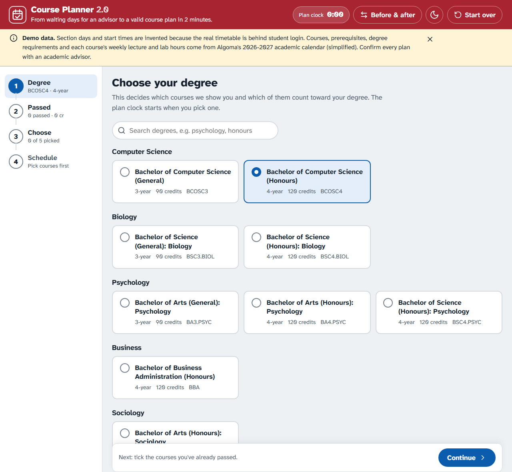
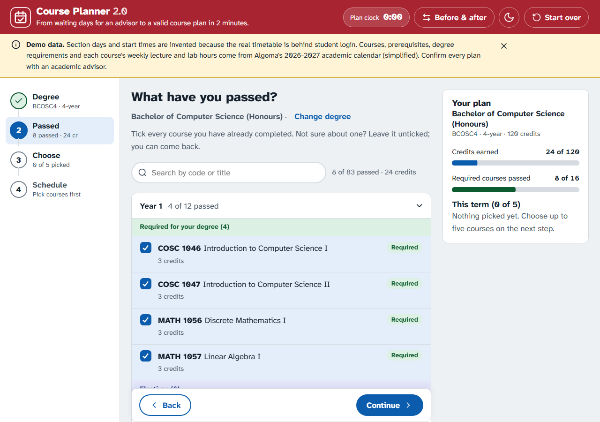
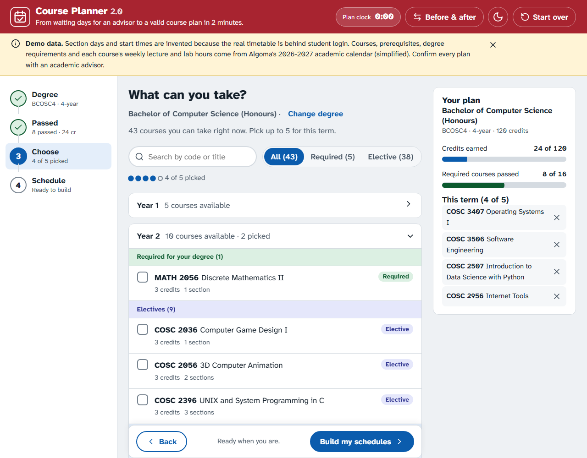
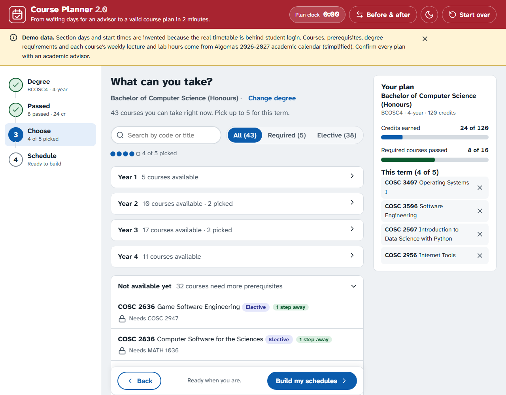
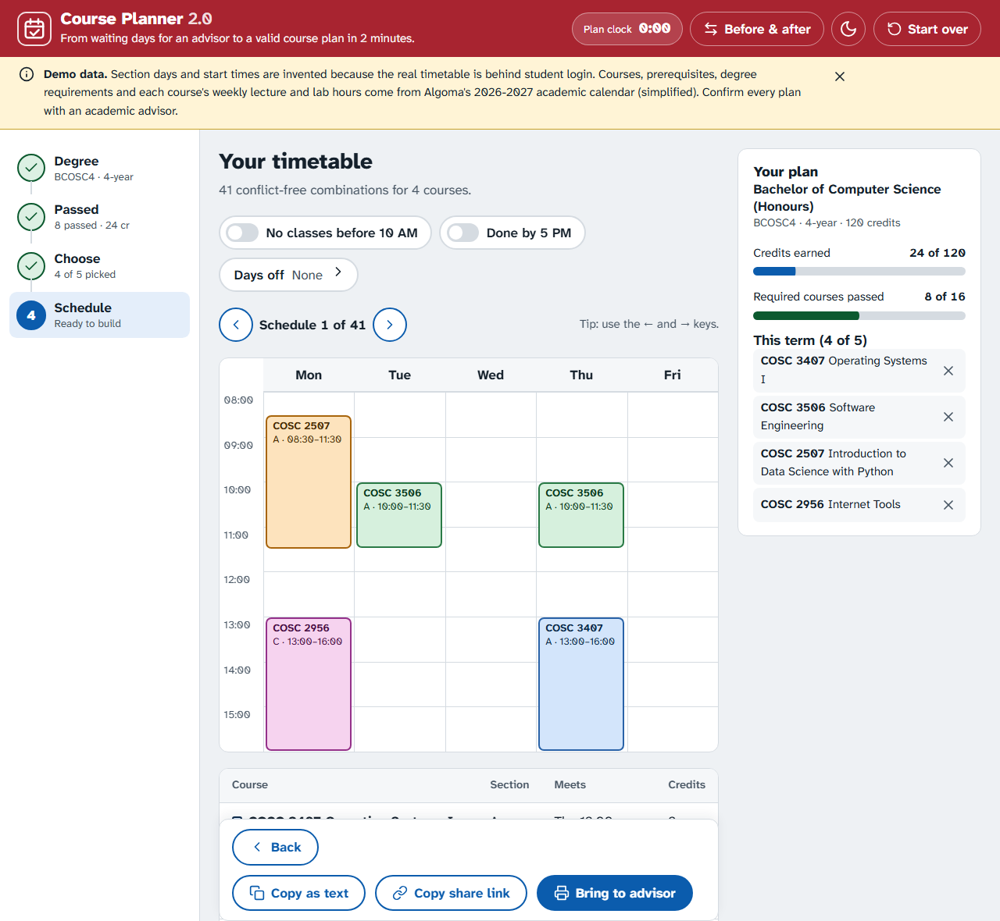
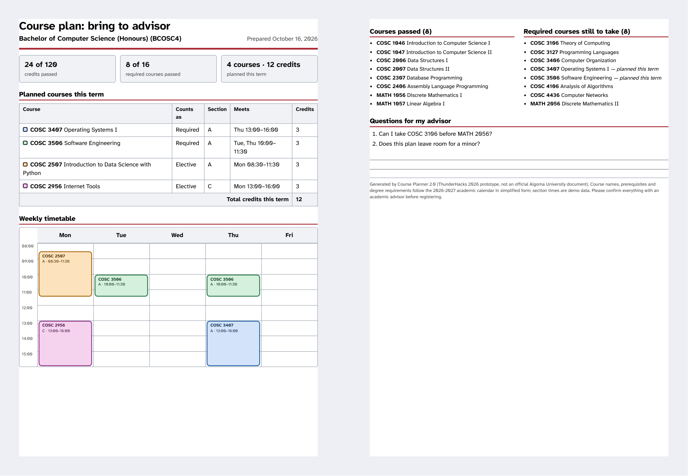
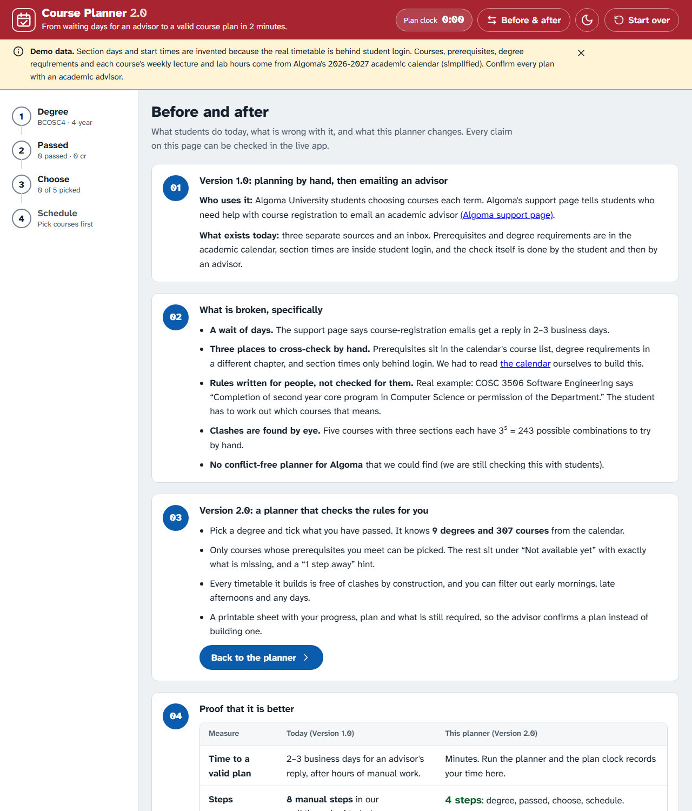
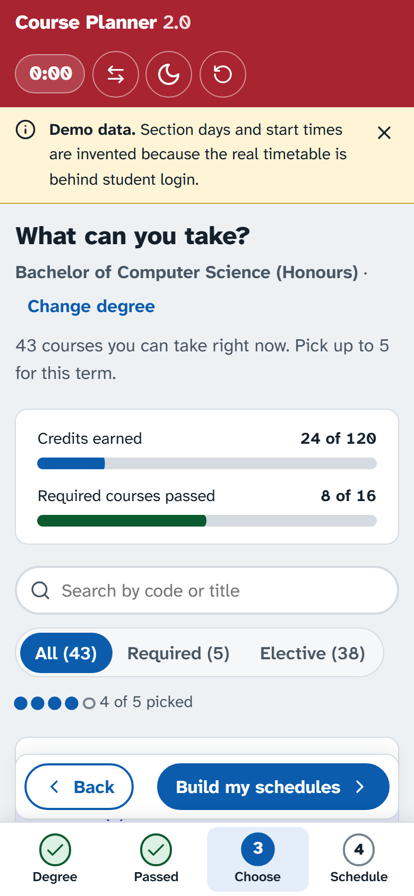
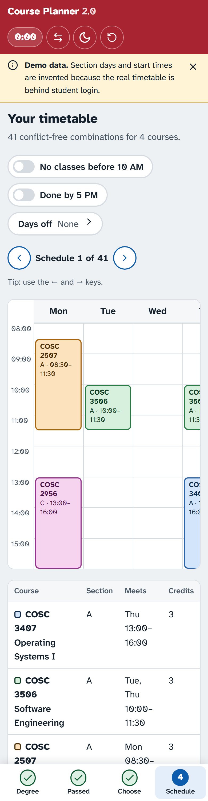
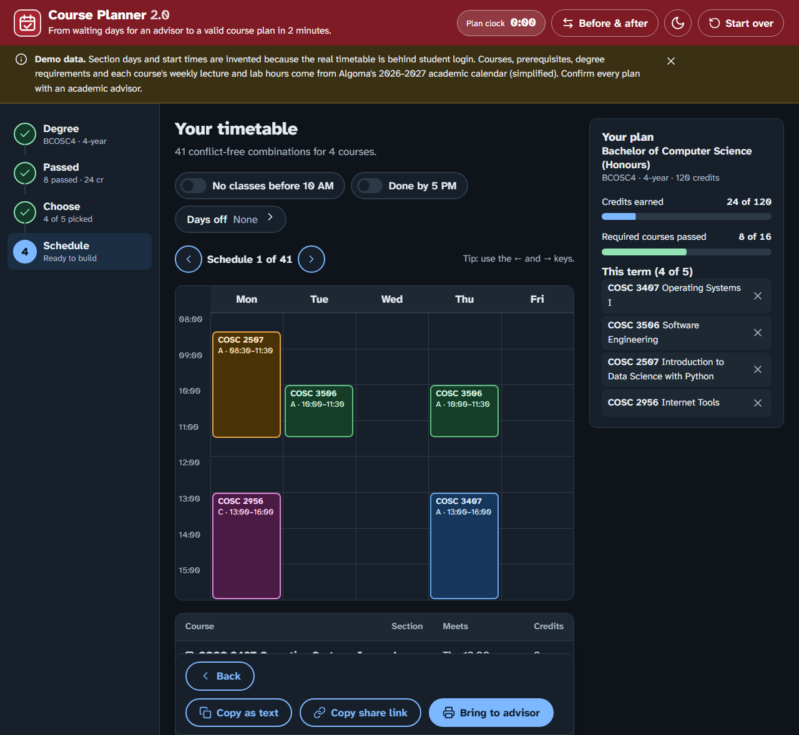

# Course Planner 2.0 (ThunderHacks 2026, Main Track "Version 2.0")

**From waiting days for an advisor to a valid course plan in 2 minutes.**

**Live demo:** https://aryano96.github.io/LayerLabs/

A prerequisite- and degree-aware course planner for Algoma University students. Pick a degree, tick the courses you've passed, choose up to five for the term, and get conflict-free timetables with a printable sheet for your advisor.

## The brief, in four parts

| Brief | Our answer |
|---|---|
| **01 Name the Version 1.0** | Planning courses by hand from the academic calendar, then emailing an advisor. Used by Algoma students every term. |
| **02 Show what is broken** | Replies take 2-3 business days ([Algoma support page](https://algomauniversity.freshservice.com/support/solutions/articles/17000006724-for-course-registration-issue)). Prerequisites, degree rules and section times live in three different places. Rules like "completion of second year core program" must be interpreted by the student. Clashes are found by eye. |
| **03 Build the Version 2.0** | This app: a working prototype with 9 real degrees and 307 real courses. |
| **04 Prove it is better** | The in-app **Before & after** page and the live **plan clock**: days to minutes, 8 manual steps to 4, ineligible picks and clashes impossible by construction. |

Open the **Before & after** button in the app's top bar for the full side-by-side.

## Screenshots

The whole flow, from choosing a degree to a printed sheet for the advisor. Every screen says that the section days and start times are demo data.

### 1. Choose your degree
Nine real Algoma degrees in five subject areas, with search.



### 2. Tick what you have passed
Courses are grouped by year, with the Required courses of your degree first. The plan panel tracks credits and required courses as you tick.



### 3. See what you can take
Only courses whose prerequisites you meet can be picked, with Required courses at the top of each year.



Anything blocked says exactly what is missing, and "1 step away" flags the courses you are closest to unlocking.



### 4. Your timetable
Every combination is free of clashes. Filter by early classes, late classes or any days off, and flip through the options.



### 5. Bring it to your advisor
A two-page sheet with your progress, your plan, the weekly timetable, what is still required, and your own questions.



### Before and after
The proof page compares the old process with the planner: the wait, the steps, the errors and who can use it.



### On a phone, and in dark mode

<p>
  
  
</p>



## Run it

```
python -m http.server
```
then open http://localhost:8000 . (Browsers block loading the data files from a plain file, so a tiny local server is needed. GitHub Pages needs no setup.)

## What is real and what is not

- **Real:** course codes, titles, credits, prerequisites, and each degree's named required courses, all parsed from Algoma's 2026-2027 academic calendar (`data/raw/parse-calendar.py`).
- **Simplified:** the calendar's "N credits from this list" rules are treated as electives.
- **Real weekly hours:** each course's lecture, lab and tutorial hours per week come from the calendar (for example "LEC 3, LAB 1.5").
- **Invented:** the **days and start times** of every section. The public site has no timetable (sections are only inside student login), so the demo uses made-up days and times. A course always meets as one 3-hour block or two 1.5-hour sessions, labs and tutorials are separate sessions, and nothing runs past 17:30. This is labelled on every screen.
- To use real sections, replace the `sections` in `data/courses.json` (format below). Everything else keeps working.

```json
{ "code": "COSC 2006", "title": "Data Structures I", "credits": 3,
  "prereqs": [["COSC 1047"], ["MATH 1056"]],
  "sections": [ { "id": "A", "meetings": [ { "day": "Mon", "start": "10:00", "end": "11:20" } ] } ] }
```
`prereqs` is a list of groups; each group needs at least one passed course (so the example means COSC 1047 AND MATH 1056).

## Another school or term

All rules and courses live in `data/courses.json` and `data/programs.json` (plus the optional `data/evidence.json`). Replace them and the planner works unchanged. `data/raw/make-demo-data.py` regenerates both files from the calendar extracts.

## Student feedback

Real interviews go in `data/evidence.json` (`{ "quote": "...", "who": "First-year CS student", "date": "2026-10-16" }`). They appear on the Before & after page. Nothing is shown while the list is empty, and quotes are rendered as plain text.

## Accessibility

Keyboard-only use, visible focus, a high-legibility typeface (Atkinson Hyperlegible Next, self-hosted), strong contrast in light and dark themes, reduced-motion support, screen-reader announcements, a text table beside the visual timetable, and a layout that works from phone to desktop. Lighthouse accessibility score: 100.

## Security and privacy

- A strict Content-Security-Policy: no inline scripts or styles, no third-party code, files load only from this site.
- No `innerHTML`; the URL, saved data and data files are checked against real course codes before use.
- No server, accounts or tracking. Your choices live in the share link and in this browser's storage only.

## Tests

- Logic: `node tests.js` (or open `tests.html` through the local server). Covers prerequisites, clashes, schedule building, filters, degrees and credits.
- Browser end-to-end checks and Lighthouse were run with Microsoft Edge during development.

## Files

`index.html`, `styles.css`, `app.js` (screens and state), `logic.js` (the rules), `theme-init.js`, `assets/`, `data/`.

Prototype built during ThunderHacks 2026. Not an official Algoma University service. Always confirm a plan with an academic advisor.
